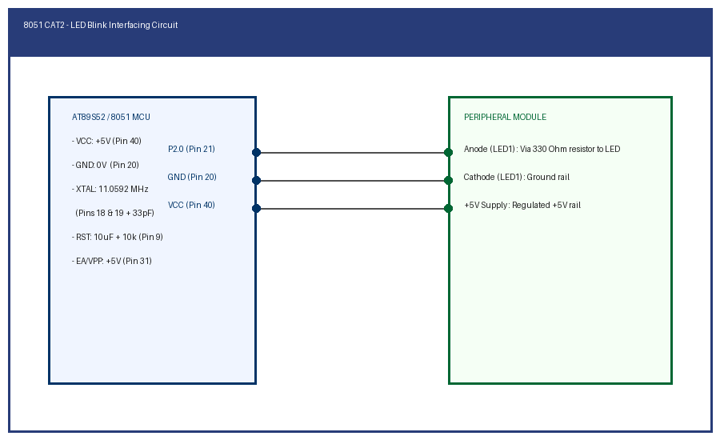

# EXPERIMENT DETAILS

**EXP:** CONTINUOUS ASSESSMENT 2

**TASK:** TASK2B

**STUDENT REGISTER NO:** 25011102088

**COURSE:** Foundations of IoT (FIoT)

**NAME OF EXP:** CAT 2 Task 2B: Bare Metal LED Blink with Delay

**HARDWARE SETUP / PLATFORM:** Embedded Development Kit + Keil / STM32CubeIDE

---

## 1. Objective
To develop and verify an embedded C firmware for the AT89S52 microcontroller that toggles an LED on Port 2 (P2.0) with a 500ms calibrated software delay loop.

---

## 2. Hardware Connections & Pin Mapping

| Microcontroller Pin | Peripheral Line | Description |
|:---:|:---:|:---|
| **P2.0** | LED Anode via 330 ohm resistor | Digital Output |
| **GND** | LED Cathode | Ground rail |
| **XTAL1/2** | 11.0592 MHz Crystal + 33pF caps | System Clock |

---

## 3. Circuit Schematic Diagram

---

## 4. Theory & Technical Overview
The 8051 microcontroller utilizes bit-addressable SFR registers for Port 2. A nested software delay loop decrements loop counters to yield approximately 500ms delay per toggle cycle based on the 1.085 us machine cycle time.

---

## 5. Build, Flash & Verification Steps
1. Open the Keil project file (`*.uvproj` or `MDK-ARM/*.uvprojx`).
2. Build the target firmware (Press `F7`).
3. Connect the hardware debugger (USBasp for 8051 or ST-Link V2 for STM32).
4. Download the compiled binary (`F8`).
5. Open serial terminal or inspect visual indicators to verify task execution.
