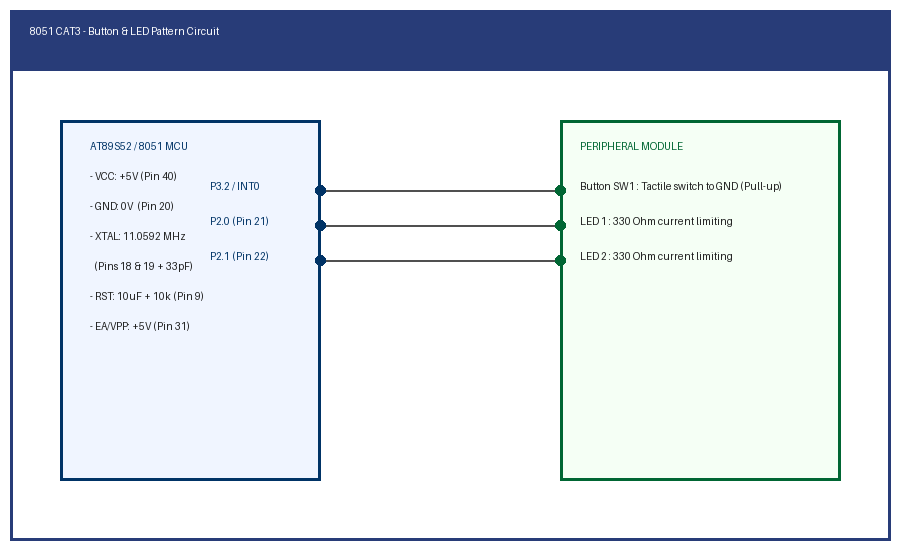

# EXPERIMENT DETAILS

**EXP:** CONTINUOUS ASSESSMENT 3

**TASK:** TASK3A

**STUDENT REGISTER NO:** 25011102088

**COURSE:** Foundations of IoT (FIoT)

**NAME OF EXP:** CAT 3 Task 3A: Push Button Input and LED Pattern Control

**HARDWARE SETUP / PLATFORM:** Embedded Development Kit + Keil / STM32CubeIDE

---

## 1. Objective
To interface external momentary tactile push-buttons to AT89S52 input pins, implement software contact debounce, and control dual LED output patterns.

---

## 2. Hardware Connections & Pin Mapping

| Microcontroller Pin | Peripheral Line | Description |
|:---:|:---:|:---|
| **P3.2 (INT0)** | Tactile Push Button SW1 | Digital Input with pull-up |
| **P2.0** | LED 1 | Active-low indicator |
| **P2.1** | LED 2 | Active-low indicator |

---

## 3. Circuit Schematic Diagram

---

## 4. Theory & Technical Overview
Writing logic 1 to Port 3.2 configures the pin as a high-impedance input. Depressing the button pulls the line to logic 0. Polling logic samples the switch state and toggles indicator LEDs.

---

## 5. Build, Flash & Verification Steps
1. Open the Keil project file (`*.uvproj` or `MDK-ARM/*.uvprojx`).
2. Build the target firmware (Press `F7`).
3. Connect the hardware debugger (USBasp for 8051 or ST-Link V2 for STM32).
4. Download the compiled binary (`F8`).
5. Open serial terminal or inspect visual indicators to verify task execution.
