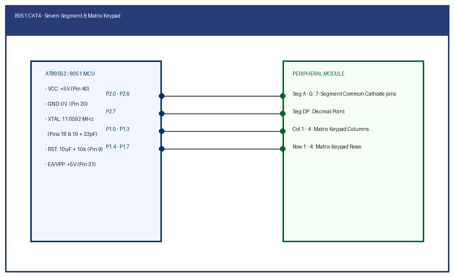

# EXPERIMENT DETAILS

**EXP:** CONTINUOUS ASSESSMENT 4

**TASK:** TASK4A

**STUDENT REGISTER NO:** 25011102088

**COURSE:** Foundations of IoT (FIoT)

**NAME OF EXP:** CAT 4 Task 4A: Seven-Segment Display Counter and Keypad HMI

**HARDWARE SETUP / PLATFORM:** Embedded Development Kit + Keil / STM32CubeIDE

---

## 1. Objective
To interface a 7-segment LED display with Port 2 of the 8051 MCU and display a repeating hexadecimal/decimal digit count sequence from 0 to 9 using a lookup table.

---

## 2. Hardware Connections & Pin Mapping

| Microcontroller Pin | Peripheral Line | Description |
|:---:|:---:|:---|
| **P2.0 - P2.6** | Segments A, B, C, D, E, F, G | Active-High segment anodes |
| **P2.7** | DP (Decimal Point) | Optional dot indicator |
| **GND** | Common Cathode Terminal | Ground rail |

---

## 3. Circuit Schematic Diagram

---

## 4. Theory & Technical Overview
A lookup table containing 7-segment hex bit patterns (0x3F for 0, 0x06 for 1, etc.) is stored in program ROM. The main loop indexes the array and writes the pattern byte directly to Port 2.

---

## 5. Build, Flash & Verification Steps
1. Open the Keil project file (`*.uvproj` or `MDK-ARM/*.uvprojx`).
2. Build the target firmware (Press `F7`).
3. Connect the hardware debugger (USBasp for 8051 or ST-Link V2 for STM32).
4. Download the compiled binary (`F8`).
5. Open serial terminal or inspect visual indicators to verify task execution.
