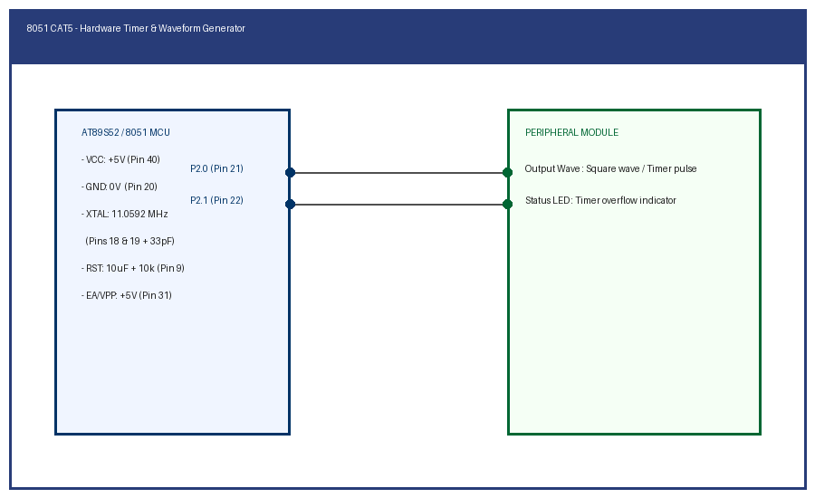

# CAT 5: 8051 Hardware Timers & Delay Generation

## Overview
Continuous Assessment 5 explores internal hardware timer architecture on the 8051 microcontroller (Timer 0 and Timer 1) in 16-bit Timer Mode 1 and 8-bit Auto-Reload Mode 2 to produce accurate timebases without processor polling spin-loops.

---

### Subtasks Index
- [TASK5A](TASK5A/): Hardware Timer 0 Mode 1 Precise Square Wave Delay
- [TASK5B](TASK5B/): Timer Modes & Periodic Waveform Generation
  - [TASK5B.1](TASK5B/TASK5B.1/): Timer 0 Mode 1 Periodic Delay Generation
