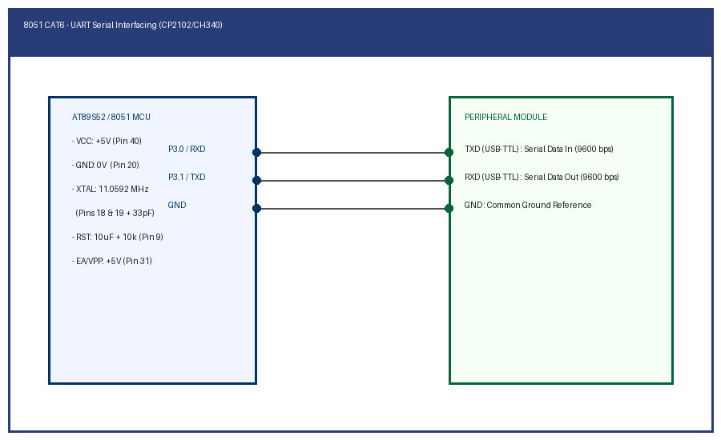

# CAT 6: 8051 Serial UART Communication

## Overview
Continuous Assessment 6 explores asynchronous serial communication on the 8051 microcontroller utilizing the on-chip UART peripheral (Mode 1, 8-bit UART, 9600 baud, 11.0592 MHz crystal) configured via Timer 1 auto-reload.

---

### Subtasks Index
- [TASK6A](TASK6A/): Full-Duplex UART Serial Transmitter at 9600 Baud (Mode 1)
