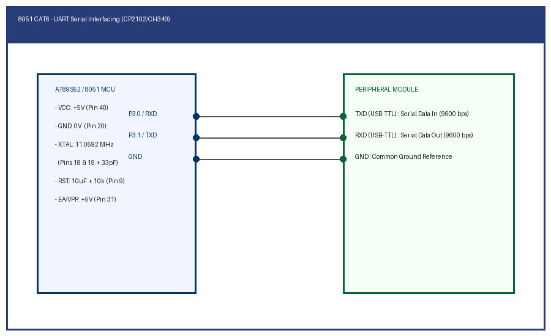

# EXPERIMENT DETAILS

**EXP:** CONTINUOUS ASSESSMENT 6

**TASK:** TASK6A

**STUDENT REGISTER NO:** 25011102088

**COURSE:** Foundations of IoT (FIoT)

**NAME OF EXP:** CAT 6 Task 6A: UART Serial Transmission at 9600 Baud

**HARDWARE SETUP / PLATFORM:** Embedded Development Kit + Keil / STM32CubeIDE

---

## 1. Objective
To initialize the 8051 full-duplex UART in Mode 1 (8-bit data, 1 stop bit) using Timer 1 in Mode 2 to generate a standard 9600 bps baud rate and continuously transmit ASCII characters.

---

## 2. Hardware Connections & Pin Mapping

| Microcontroller Pin | Peripheral Line | Description |
|:---:|:---:|:---|
| **P3.1 (TXD)** | USB-TTL RXD | Serial Data Out |
| **GND** | USB-TTL GND | Common Ground |
| **Internal** | Timer 1 (TH1=0xFD) | Baud generator @ 11.0592 MHz |

---

## 3. Circuit Schematic Diagram

---

## 4. Theory & Technical Overview
Timer 1 auto-reload value TH1=0xFD produces 9600 baud with crystal 11.0592 MHz. Data written to SBUF transmits through TXD pin; the TI flag signals completion.

---

## 5. Build, Flash & Verification Steps
1. Open the Keil project file (`*.uvproj` or `MDK-ARM/*.uvprojx`).
2. Build the target firmware (Press `F7`).
3. Connect the hardware debugger (USBasp for 8051 or ST-Link V2 for STM32).
4. Download the compiled binary (`F8`).
5. Open serial terminal or inspect visual indicators to verify task execution.
