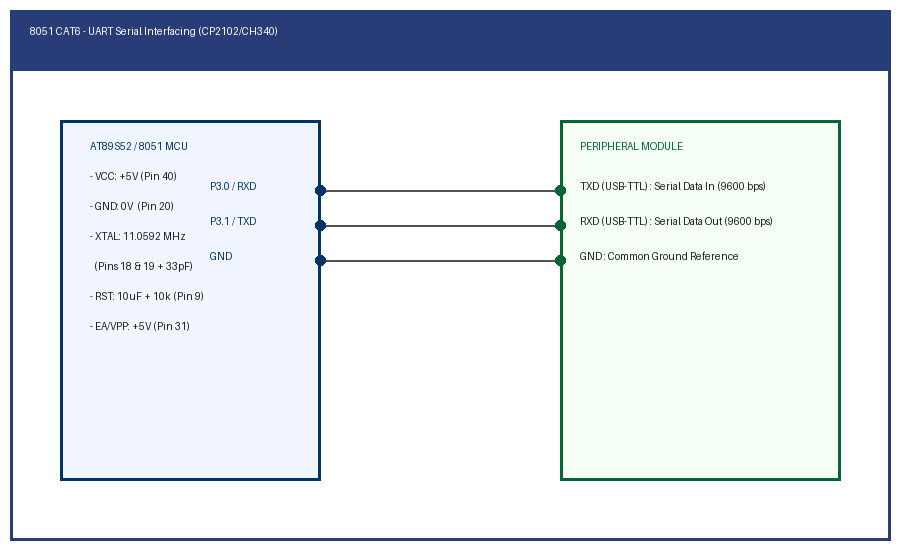

# EXPERIMENT DETAILS

**EXP:** CONTINUOUS ASSESSMENT 6

**TASK:** TASK6B

**STUDENT REGISTER NO:** 25011102088

**COURSE:** Foundations of IoT (FIoT)

**NAME OF EXP:** CAT 6 Task 6B: UART Serial Echo & Interactive Terminal

**HARDWARE SETUP / PLATFORM:** Embedded Development Kit + Keil / STM32CubeIDE

---

## 1. Objective
To implement full-duplex UART serial receive and echo, receiving incoming ASCII characters over P3.0 (RXD) and immediately retransmitting them over P3.1 (TXD) to the terminal.

---

## 2. Hardware Connections & Pin Mapping

| Microcontroller Pin | Peripheral Line | Description |
|:---:|:---:|:---|
| **P3.0 (RXD)** | USB-TTL TXD | Serial Data In |
| **P3.1 (TXD)** | USB-TTL RXD | Serial Data Out |
| **GND** | USB-TTL GND | Common Ground |

---

## 3. Circuit Schematic Diagram

---

## 4. Theory & Technical Overview
REN bit in SCON enables receiver. When a byte arrives, RI flag asserts. The firmware fetches SBUF and echoes it back through SBUF transmission.

---

## 5. Build, Flash & Verification Steps
1. Open the Keil project file (`*.uvproj` or `MDK-ARM/*.uvprojx`).
2. Build the target firmware (Press `F7`).
3. Connect the hardware debugger (USBasp for 8051 or ST-Link V2 for STM32).
4. Download the compiled binary (`F8`).
5. Open serial terminal or inspect visual indicators to verify task execution.
