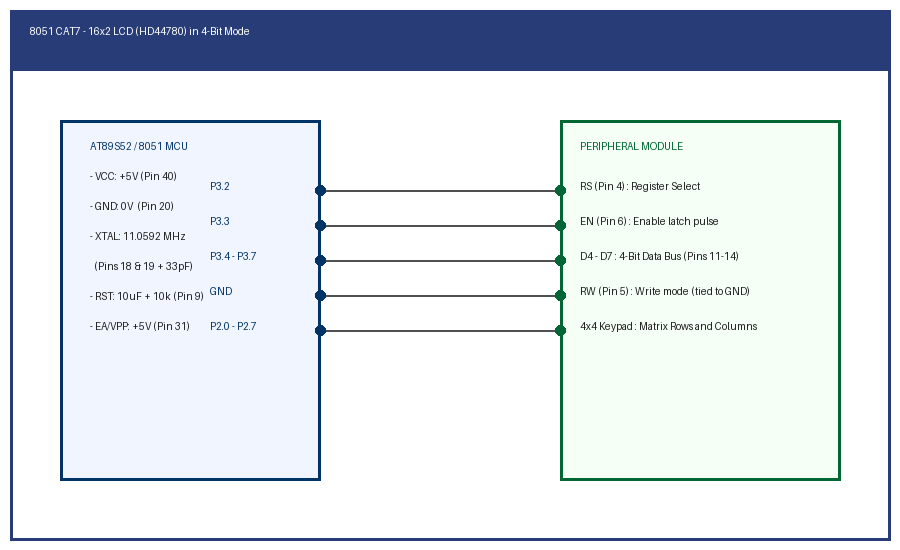

# EXPERIMENT DETAILS

**EXP:** CONTINUOUS ASSESSMENT 7

**TASK:** TASK7A

**STUDENT REGISTER NO:** 25011102088

**COURSE:** Foundations of IoT (FIoT)

**NAME OF EXP:** CAT 7 Task 7A: 16x2 Character LCD Initialization & Text Display

**HARDWARE SETUP / PLATFORM:** Embedded Development Kit + Keil / STM32CubeIDE

---

## 1. Objective
To interface an HD44780-compatible 16x2 alphanumeric LCD display with the 8051 MCU in 4-bit data mode and display static text strings.

---

## 2. Hardware Connections & Pin Mapping

| Microcontroller Pin | Peripheral Line | Description |
|:---:|:---:|:---|
| **P3.2** | RS (Pin 4) | Register Select |
| **P3.3** | EN (Pin 6) | Enable Latch |
| **P3.4 - P3.7** | D4 - D7 | 4-Bit Data Bus |

---

## 3. Circuit Schematic Diagram

---

## 4. Theory & Technical Overview
4-bit mode transmits 8-bit commands in two sequential nibbles (upper nibble followed by lower nibble). Initialization commands (0x02, 0x28, 0x0C, 0x01) configure the controller.

---

## 5. Build, Flash & Verification Steps
1. Open the Keil project file (`*.uvproj` or `MDK-ARM/*.uvprojx`).
2. Build the target firmware (Press `F7`).
3. Connect the hardware debugger (USBasp for 8051 or ST-Link V2 for STM32).
4. Download the compiled binary (`F8`).
5. Open serial terminal or inspect visual indicators to verify task execution.
