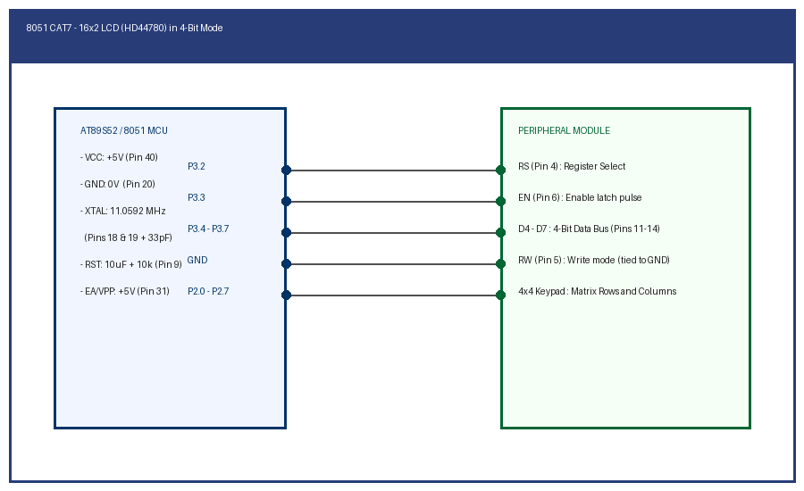

# EXPERIMENT DETAILS

**EXP:** CONTINUOUS ASSESSMENT 7

**TASK:** TASK7B

**STUDENT REGISTER NO:** 25011102088

**COURSE:** Foundations of IoT (FIoT)

**NAME OF EXP:** CAT 7 Task 7B: LCD Dynamic Value Counter & Cursor Positioning

**HARDWARE SETUP / PLATFORM:** Embedded Development Kit + Keil / STM32CubeIDE

---

## 1. Objective
To control LCD DDRAM addresses to position the cursor dynamically and update a continuous numerical counter (00 to 99) in real time.

---

## 2. Hardware Connections & Pin Mapping

| Microcontroller Pin | Peripheral Line | Description |
|:---:|:---:|:---|
| **P3.2 - P3.7** | LCD Control & 4-bit Data | HD44780 Interfacing Bus |
| **V0 (Pin 3)** | Contrast Potentiometer | 10k ohm wiper |

---

## 3. Circuit Schematic Diagram

---

## 4. Theory & Technical Overview
Commands 0x80 (Line 1) and 0xC0 (Line 2) position the DDRAM cursor. Integer values are split into ASCII characters ('0' + digit) and sent via data registers.

---

## 5. Build, Flash & Verification Steps
1. Open the Keil project file (`*.uvproj` or `MDK-ARM/*.uvprojx`).
2. Build the target firmware (Press `F7`).
3. Connect the hardware debugger (USBasp for 8051 or ST-Link V2 for STM32).
4. Download the compiled binary (`F8`).
5. Open serial terminal or inspect visual indicators to verify task execution.
