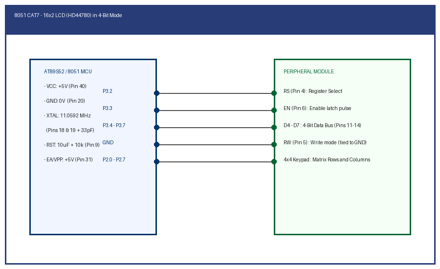

# EXPERIMENT DETAILS

**EXP:** CONTINUOUS ASSESSMENT 7

**TASK:** TASK7C

**STUDENT REGISTER NO:** 25011102088

**COURSE:** Foundations of IoT (FIoT)

**NAME OF EXP:** CAT 7 Task 7C: 4x4 Matrix Keypad Input to LCD Alphanumeric Display

**HARDWARE SETUP / PLATFORM:** Embedded Development Kit + Keil / STM32CubeIDE

---

## 1. Objective
To interface a 4x4 matrix keypad and display pressed key characters ('0'-'9', 'A'-'D') in real time on the 16x2 LCD.

---

## 2. Hardware Connections & Pin Mapping

| Microcontroller Pin | Peripheral Line | Description |
|:---:|:---:|:---|
| **P2.4 - P2.7** | Rows R1 - R4 | Matrix Row Outputs |
| **P2.0 - P2.3** | Cols C1 - C4 | Matrix Column Inputs with pull-ups |
| **P3.2 - P3.7** | LCD Bus | Display interface |

---

## 3. Circuit Schematic Diagram

---

## 4. Theory & Technical Overview
Matrix scanning sequentially grounds row lines while checking column lines for logic low. The detected matrix coordinate is converted into ASCII and rendered on the LCD.

---

## 5. Build, Flash & Verification Steps
1. Open the Keil project file (`*.uvproj` or `MDK-ARM/*.uvprojx`).
2. Build the target firmware (Press `F7`).
3. Connect the hardware debugger (USBasp for 8051 or ST-Link V2 for STM32).
4. Download the compiled binary (`F8`).
5. Open serial terminal or inspect visual indicators to verify task execution.
