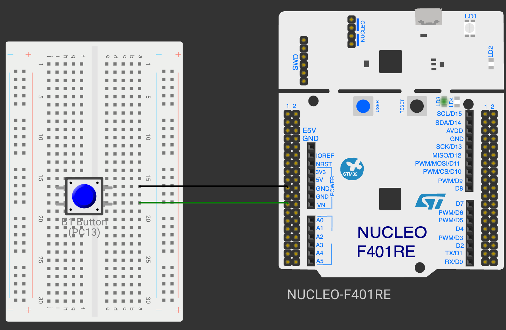

# CAT 11: STM32 USART Telemetry & Peripheral Drivers

## Overview
Continuous Assessment 11 demonstrates serial telemetry communication on STM32 ARM Cortex-M4 utilizing the USART2 peripheral interface at 115200 baud with periodic system heartbeat monitoring.

---

### Subtasks Index
- [TASK11A](TASK11A/): STM32 USART2 Telemetry Stream & System Heartbeat
