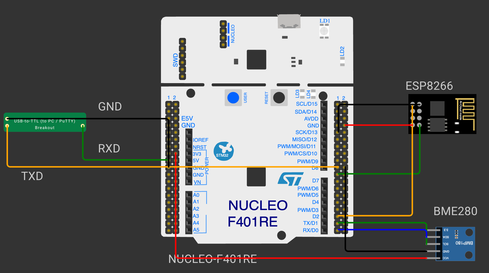

# CONTINUOUS ASSESSMENT 12

## Bosch BME280 Sensor Interfacing via I2C

**STUDENT REGISTER NO:** 25011102088  
**COURSE:** Foundations of IoT (FIoT)

---

### Overview
This folder contains the practical implementations, firmware source code, Keil/STM32CubeIDE projects, and hardware documentation for Bosch BME280 Sensor Interfacing via I2C.

### Circuit Schematic

---

### Subtasks Index
Please refer to the subtask directories for individual source code, compilation targets, and technical reports.
