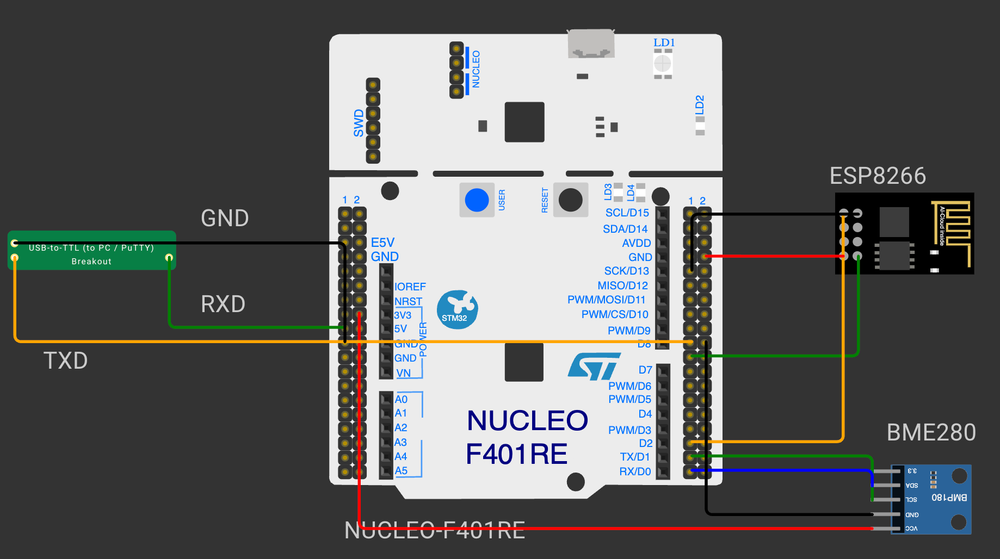

# EXPERIMENT DETAILS

**EXP:** CONTINUOUS ASSESSMENT 12

**TASK:** TASK12A

**STUDENT REGISTER NO:** 25011102088

**COURSE:** Foundations of IoT (FIoT)

**NAME OF EXP:** CAT 12 Task 12A: Bosch BME280 I2C Initialization & Device ID

**HARDWARE SETUP / PLATFORM:** Embedded Development Kit + Keil / STM32CubeIDE

---

## 1. Objective
To configure I2C1 peripheral on PB6 (SCL) and PB7 (SDA) at 400 kHz Fast Mode, ping BME280 at address 0x76/0x77, and verify chip ID 0x60.

---

## 2. Hardware Connections & Pin Mapping

| Microcontroller Pin | Peripheral Line | Description |
|:---:|:---:|:---|
| **PB6** | I2C1_SCL | Clock Line (with 4.7k pull-up) |
| **PB7** | I2C1_SDA | Data Line (with 4.7k pull-up) |

---

## 3. Circuit Schematic Diagram

---

## 4. Theory & Technical Overview
The experiment utilizes embedded peripheral drivers, hardware abstraction libraries, and structured control flow to achieve real-time deterministic execution.

---

## 5. Build, Flash & Verification Steps
1. Open the Keil project file (`*.uvproj` or `MDK-ARM/*.uvprojx`).
2. Build the target firmware (Press `F7`).
3. Connect the hardware debugger (USBasp for 8051 or ST-Link V2 for STM32).
4. Download the compiled binary (`F8`).
5. Open serial terminal or inspect visual indicators to verify task execution.
