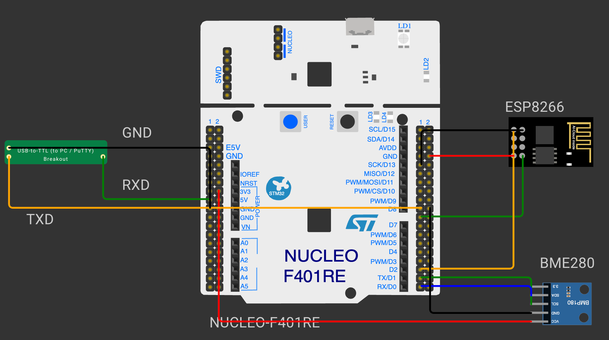

# EXPERIMENT DETAILS

**EXP:** CONTINUOUS ASSESSMENT 12

**TASK:** TASK12B

**STUDENT REGISTER NO:** 25011102088

**COURSE:** Foundations of IoT (FIoT)

**NAME OF EXP:** CAT 12 Task 12B: BME280 Temperature Compensation Readout

**HARDWARE SETUP / PLATFORM:** Embedded Development Kit + Keil / STM32CubeIDE

---

## 1. Objective
To sample raw 20-bit temperature ADC registers, apply factory calibration trimming parameters, and compute ambient temperature in degrees Celsius.

---

## 2. Hardware Connections & Pin Mapping

| Microcontroller Pin | Peripheral Line | Description |
|:---:|:---:|:---|
| **PB6 / PB7** | I2C1 Bus | 400 kHz Fast Mode |
| **PA2** | USART2_TX | Debug Serial Console |

---

## 3. Circuit Schematic Diagram

---

## 4. Theory & Technical Overview
The experiment utilizes embedded peripheral drivers, hardware abstraction libraries, and structured control flow to achieve real-time deterministic execution.

---

## 5. Build, Flash & Verification Steps
1. Open the Keil project file (`*.uvproj` or `MDK-ARM/*.uvprojx`).
2. Build the target firmware (Press `F7`).
3. Connect the hardware debugger (USBasp for 8051 or ST-Link V2 for STM32).
4. Download the compiled binary (`F8`).
5. Open serial terminal or inspect visual indicators to verify task execution.
