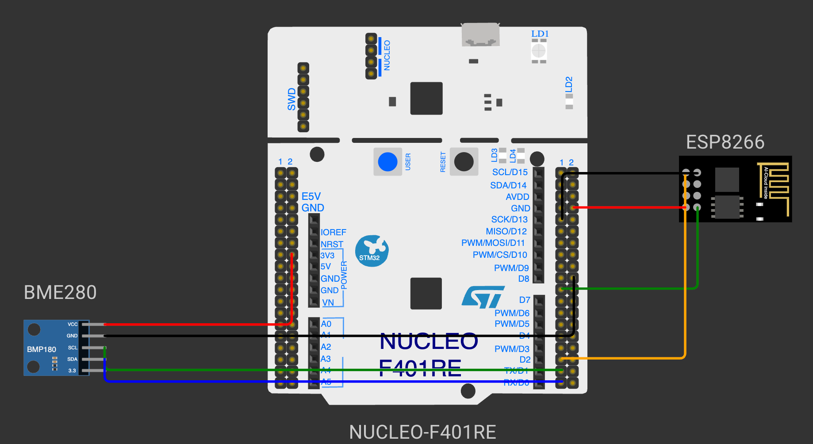

# CAT 13: MQTT Protocol & Cloud Telemetry

## Overview
Continuous Assessment 13 explores cloud messaging protocols for IoT edge systems using MQTT over TCP/IP via the ESP8266 Wi-Fi transceiver interfaced with the STM32 ARM Cortex-M4 microcontroller.

---

### Subtasks Index
- [TASK13](TASK13/): MQTT Protocol Telemetry Publisher via ESP8266 Wi-Fi
