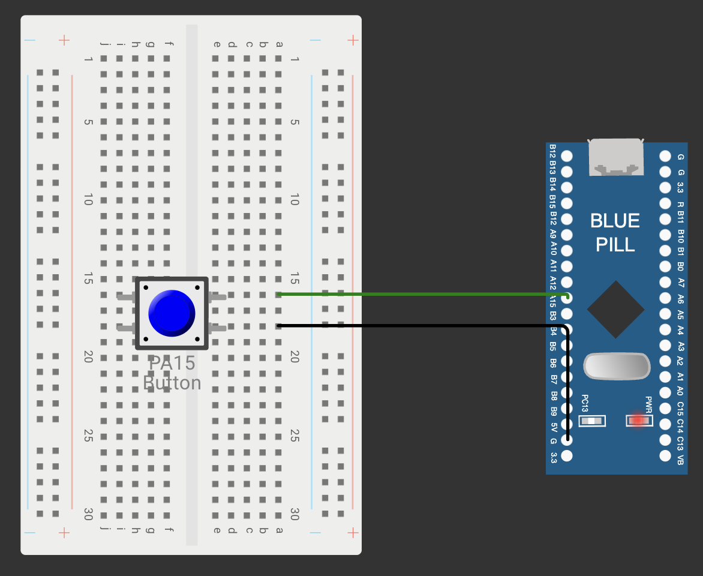

# CAT 14: Multi-Sensor Telemetry & Edge Gateway Integration

## Overview
Continuous Assessment 14 demonstrates the integration of multiple sensor interfaces (I2C) with high-speed serial transceivers on the STM32 ARM Cortex-M4 platform to establish an embedded edge telemetry gateway.

---

### Subtasks Index
- [TASK14](TASK14/): Multi-Sensor Telemetry & Edge Gateway Integration
