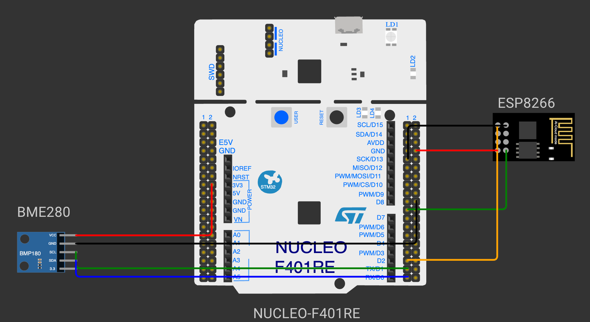

# EXPERIMENT DETAILS

**EXP:** CONTINUOUS ASSESSMENT 14

**TASK:** TASK14

**STUDENT REGISTER NO:** 25011102088

**COURSE:** Foundations of IoT (FIoT)

**NAME OF EXP:** CAT 14 Task 14: End-to-End Capstone IoT Weather Telemetry Station

**HARDWARE SETUP / PLATFORM:** Embedded Development Kit + Keil / STM32CubeIDE

---

## 1. Objective
To integrate Bosch BME280 sensor acquisition over I2C with ESP8266 Wi-Fi connectivity and stream formatted JSON telemetry to MQTT cloud brokers.

---

## 2. Hardware Connections & Pin Mapping

| Microcontroller Pin | Peripheral Line | Description |
|:---:|:---:|:---|
| **PB6 / PB7** | I2C1 | BME280 Sensor |
| **PA9 / PA10** | USART1 | ESP8266 Wi-Fi |
| **PA2 / PA3** | USART2 | Debug Console |

---

## 3. Circuit Schematic Diagram

---

## 4. Theory & Technical Overview
The experiment utilizes embedded peripheral drivers, hardware abstraction libraries, and structured control flow to achieve real-time deterministic execution.

---

## 5. Build, Flash & Verification Steps
1. Open the Keil project file (`*.uvproj` or `MDK-ARM/*.uvprojx`).
2. Build the target firmware (Press `F7`).
3. Connect the hardware debugger (USBasp for 8051 or ST-Link V2 for STM32).
4. Download the compiled binary (`F8`).
5. Open serial terminal or inspect visual indicators to verify task execution.
