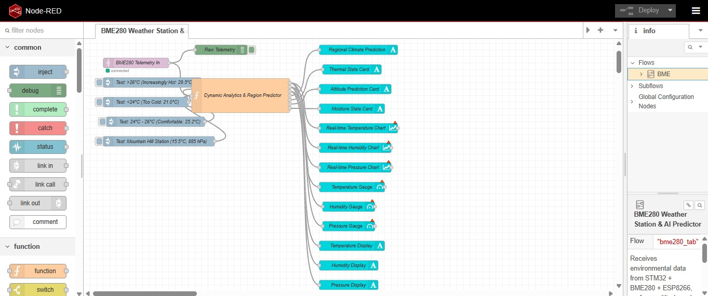
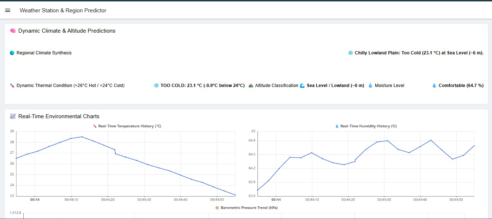
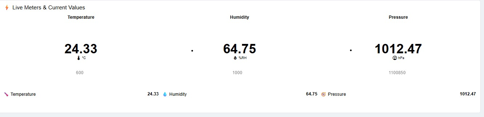
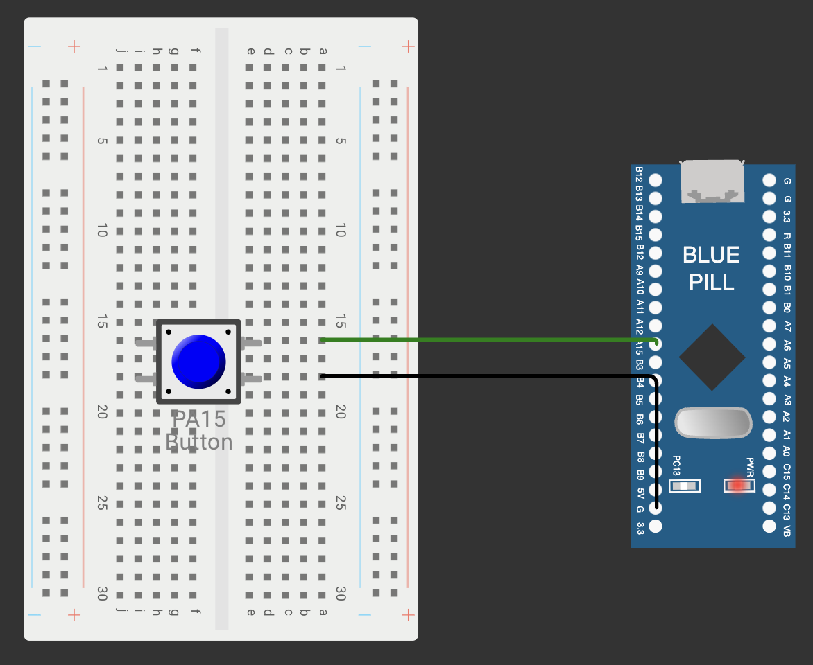

# CAT 15: Capstone IoT Project Folder

## Overview
Continuous Assessment 15 represents the Capstone IoT Project. It integrates:
- **Embedded Edge Sensing**: Bosch BME280 temperature, barometric pressure, and relative humidity sensor acquired via I2C1.
- **Compute Platform**: STM32 Nucleo-64 (ARM Cortex-M4 @ 84 MHz) with HAL peripheral drivers.
- **Wireless Connectivity**: ESP8266 Wi-Fi SoC operated in Station Mode via AT commands over USART1.
- **Cloud Telemetry**: Lightweight MQTT publish/subscribe messaging over TCP (`broker.emqx.io:1883`) to topic `college/weather/bme280`.
- **Live Cloud Dashboard**: Node-RED interactive visualization interface (`/dashboard`) featuring real-time gauges, trend charts, and environmental boundary classifications.

---

### Project Visualizations

| Dashboard View (`proj1`) | Node-RED Flow (`proj2`) | Debug Console (`proj3`) |
|:---:|:---:|:---:|
|  |  |  |

---

### Circuit Interfacing Schematic

---

### Subtasks Index
- [TASK15](TASK15/): Capstone IoT Weather Station & AI Predictor with Node-RED Dashboard
