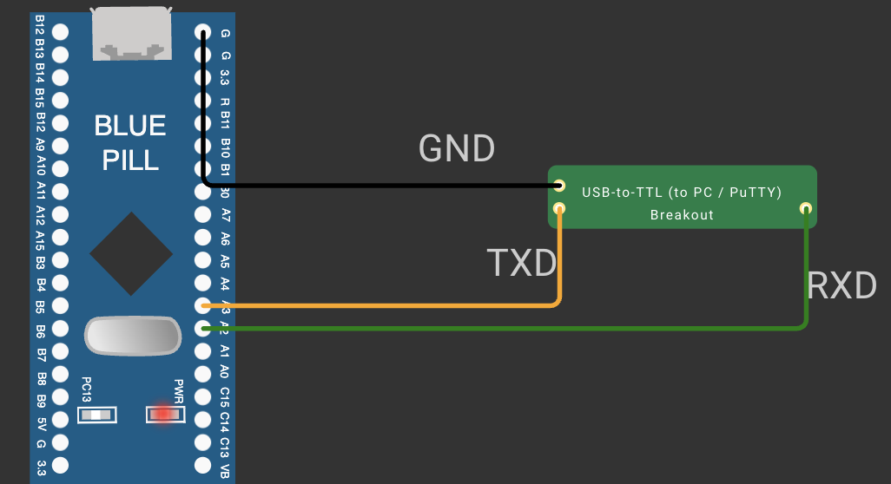

# CAT 9: STM32 Hardware Timers & Serial Control

## Overview
Continuous Assessment 9 explores STM32 ARM Cortex-M hardware peripheral timers and serial command reception for embedded control systems.

---

### Subtasks Index
- [TASK9A](TASK9A/): Interactive Serial Command Parser & LED Controller
